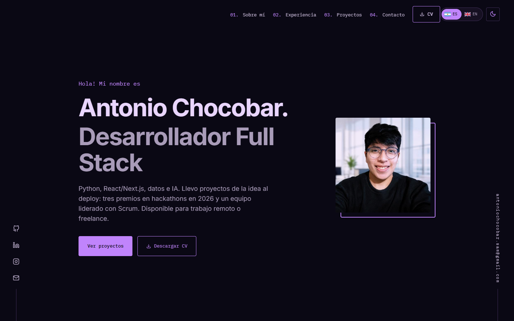
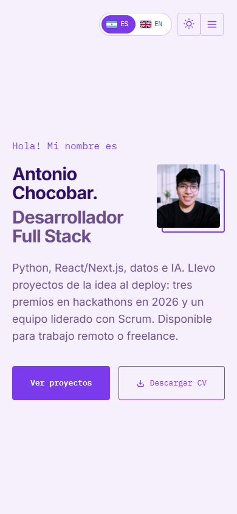

# Antonio Chocobar · Portafolio

Portafolio personal de Antonio Chocobar, desarrollador full stack (Python, React/Next.js, datos e IA) en Salta, Argentina.

**Sitio en vivo:** https://antony27c.github.io/Portafolio/



## Características
- Bilingüe (español / inglés) y modo claro / oscuro.
- Secciones: sobre mí, experiencia y logros, proyectos destacados, más proyectos y contacto.
- Formulario de contacto con Formspree, enviado sin salir del sitio.
- CV descargable en PDF.
- Responsive, accesible por teclado y respeta `prefers-reduced-motion`.

## Tecnologías
- React 19 + Vite
- CSS propio (sin frameworks), íconos SVG inline
- Deploy automático a GitHub Pages con GitHub Actions

## Desarrollo
```bash
npm install
npm run dev     # servidor local en http://localhost:5173/Portafolio/
npm run build   # build de producción en dist/
```

Los textos están en `src/i18n.js` y el contenido (proyectos, experiencia, habilidades, redes) en `src/data/`.

## Mobile

